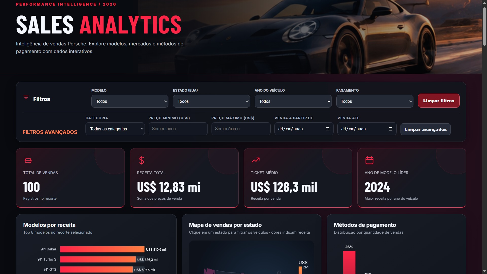
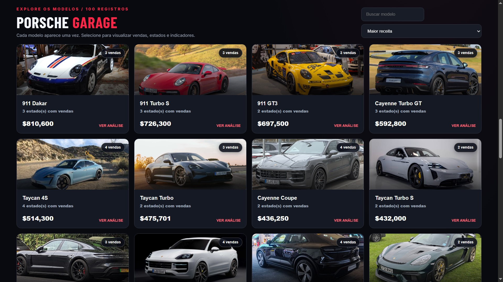

# Porsche Sales Dashboard

### Dashboard interativa de análise de vendas | HTML, CSS, JavaScript e Plotly.js

Uma aplicação web desenvolvida para explorar dados de vendas de veículos Porsche por meio de indicadores comerciais, gráficos interativos, filtros avançados e visualizações geográficas.

O projeto foi desenvolvido como parte de um desafio prático da **DIO (Digital Innovation One)**, com foco em análise de dados, visualização de informações e desenvolvimento front-end.

**[Acessar Dashboard Online](https://jrmateusalmeida.github.io/porsche-sales-dashboard/)** | **[Código-fonte](https://github.com/jrmateusalmeida/porsche-sales-dashboard)**

---

## Sobre o projeto

A Porsche Sales Dashboard transforma uma base de dados de vendas em uma experiência visual interativa, permitindo analisar o desempenho comercial de diferentes modelos Porsche no mercado norte-americano.

A aplicação utiliza uma interface inspirada na identidade visual esportiva da marca, com tema escuro, detalhes em vermelho, gráficos dinâmicos e uma garagem virtual de veículos.

O objetivo é facilitar a interpretação dos dados e permitir que o usuário explore diferentes cenários comerciais sem precisar manipular planilhas.

## Indicadores principais

A dashboard apresenta indicadores calculados dinamicamente conforme os filtros selecionados:

- Total de veículos vendidos.
- Receita total em dólares americanos (USD).
- Ticket médio por venda.
- Ano de modelo com maior receita.
- Modelo líder em vendas.
- Estado com maior faturamento.
- Participação dos modelos no resultado.
- Maior venda individual.

## Visualizações e análises

### 1. Modelos por receita

Identificação dos modelos que apresentam maior contribuição para o faturamento total.

### 2. Mapa de vendas por estado

Visualização geográfica interativa das vendas nos Estados Unidos, permitindo explorar o desempenho por região.

### 3. Métodos de pagamento

Análise da distribuição das modalidades de pagamento utilizadas nas transações.

### 4. Evolução mensal das vendas

Gráfico temporal que permite acompanhar a evolução do faturamento e do volume de vendas ao longo dos meses.

### 5. Ranking dos modelos

Classificação dos dez principais modelos, com possibilidade de comparar desempenho por quantidade vendida ou receita.

### 6. Distribuição por categoria

Análise da participação de SUVs, esportivos e sedãs nas vendas.

### 7. Mapa de calor

Matriz interativa que cruza modelos Porsche e estados americanos, destacando a concentração das vendas.

## Porsche Garage

Uma das funcionalidades do projeto é a **Porsche Garage**, um catálogo visual interativo com 40 modelos de veículos.

Cada modelo possui um cartão com fotografia, quantidade de vendas e faturamento.

Ao selecionar um veículo, o usuário pode consultar informações detalhadas, incluindo distribuição geográfica das vendas e registros comerciais associados ao modelo.

## Filtros interativos

A aplicação permite refinar as análises por:

- Modelo do veículo.
- Estado americano.
- Ano do modelo.
- Método de pagamento.
- Categoria do veículo.
- Faixa de preço.
- Intervalo de datas das vendas.

Os indicadores e gráficos são atualizados conforme os filtros aplicados.

## Base de dados e tratamento

A base utilizada no projeto foi disponibilizada no contexto do desafio da DIO.

**Características da base:**

| Característica | Quantidade |
|---|---:|
| Registros de vendas | 100 |
| Modelos distintos | 40 |
| Mercado analisado | Estados Unidos |
| Moeda | USD |

Durante a preparação dos dados, foram identificados problemas relacionados à padronização e validade de datas.

O processo de tratamento envolveu identificação de registros inconsistentes, revisão em planilha Excel, conversão de formatos e integração das datas editadas ao JavaScript.

**Nota de qualidade:** algumas datas foram ajustadas manualmente para permitir a análise temporal. Esses ajustes não devem ser interpretados como confirmação documental das datas originais das transações.

## Tecnologias utilizadas

| Tecnologia | Aplicação |
|---|---|
| HTML5 | Estrutura da aplicação |
| CSS3 | Estilização e layout responsivo |
| JavaScript | Manipulação dos dados, filtros e interatividade |
| Plotly.js | Gráficos e visualizações interativas |
| Microsoft Excel | Organização e revisão da base de dados |
| Git e GitHub | Versionamento e publicação |
| GitHub Pages | Hospedagem da aplicação |

A aplicação é estática e não necessita de backend para apresentar os dados.

## Como executar

**Opção 1 — Online**

Acesse diretamente:

https://jrmateusalmeida.github.io/porsche-sales-dashboard/

**Opção 2 — Localmente**

1. Clone o repositório:

   `git clone https://github.com/jrmateusalmeida/porsche-sales-dashboard.git`

2. Abra a pasta do projeto.
3. Execute o arquivo `index.html` em um navegador moderno.

É necessária conexão com a internet para carregar determinadas bibliotecas e fotografias externas.

## Perguntas de negócio

A dashboard foi desenvolvida para apoiar a investigação de questões como:

1. Quais modelos Porsche geram maior faturamento?
2. Quais estados americanos apresentam maior concentração de vendas?
3. Quais métodos de pagamento são mais utilizados?
4. Como o faturamento evolui ao longo do tempo?
5. Quais categorias de veículos possuem maior participação comercial?
6. Como as vendas se distribuem entre modelos e regiões?

## Aprendizados

Durante o desenvolvimento, foram trabalhados conceitos de:

- Limpeza e padronização de dados.
- Análise exploratória e indicadores de desempenho.
- Manipulação de arrays e objetos em JavaScript.
- Construção de gráficos interativos.
- Filtros combinados e atualização dinâmica de interfaces.
- Desenvolvimento de layouts responsivos.
- Organização e publicação de projetos no GitHub.

## Melhorias futuras

- Exportação de relatórios em PDF ou CSV.
- Comparação entre períodos comerciais.
- Novas métricas de desempenho.
- Integração

## Prévia da Dashboard

### Visão geral

### Porsche Garage

### Porsche Garage

